# 📱 Expend — UI & Design Showcase

<a href="https://github.com/apandey-dev/expend">
  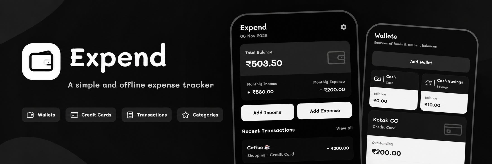
</a>

  <strong>A complete visual tour of Expend's quiet, monochrome aesthetic across AMOLED Night and Clean Day themes.</strong>

  <a href="README.md">← Back to README</a> &nbsp;·&nbsp;
  <a href="#amoled-night-vs-clean-day">Theme Comparison</a> &nbsp;·&nbsp;
  <a href="#wallets--credit-card-accounting">Wallets &amp; Credit Cards</a> &nbsp;·&nbsp;
  <a href="#category-system--icon-picker">Categories &amp; Icons</a> &nbsp;·&nbsp;
  <a href="#transaction-management">Transactions</a>

---

## 🌓 AMOLED Night vs Clean Day

Expend offers two handcrafted monochrome themes: **AMOLED Night** (pure `#000000` with charcoal cards) and **Clean Day** (warm paper-white with dark charcoal accents).

### 1. Home Dashboard
*Featuring the prominent Total Balance banner, subtle wallet watermark, Monthly Income & Expense breakdown, and Quick Action buttons.*

| AMOLED Night Mode | Clean Day Mode |
|:---:|:---:|
| 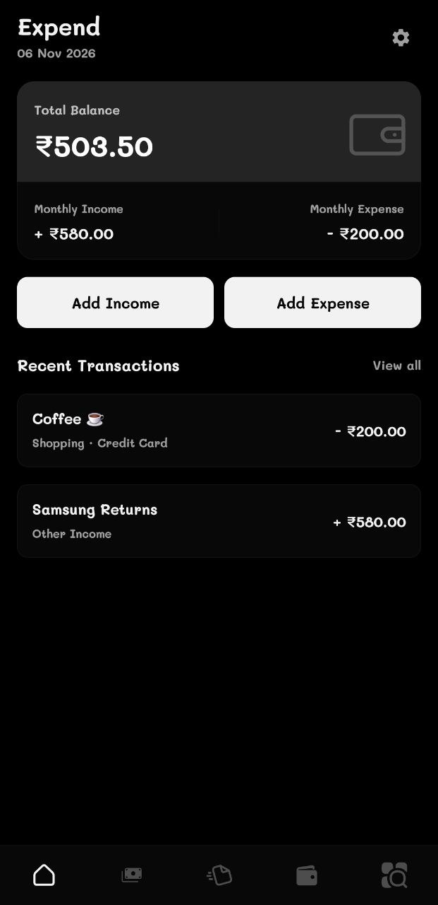 | 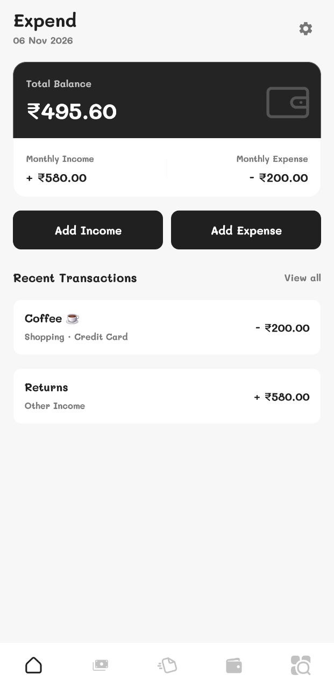 |
| **AMOLED Night:** Pure black background with charcoal container | **Clean Day:** Paper white with dark contrast balance tile |

---

### 2. Wallets & Credit Card Cards
*Featuring dual-section credit cards (outstanding debt, total limit, available spending) and normal wallets with category glyphs.*

| AMOLED Night Wallets | Clean Day Wallets |
|:---:|:---:|
| 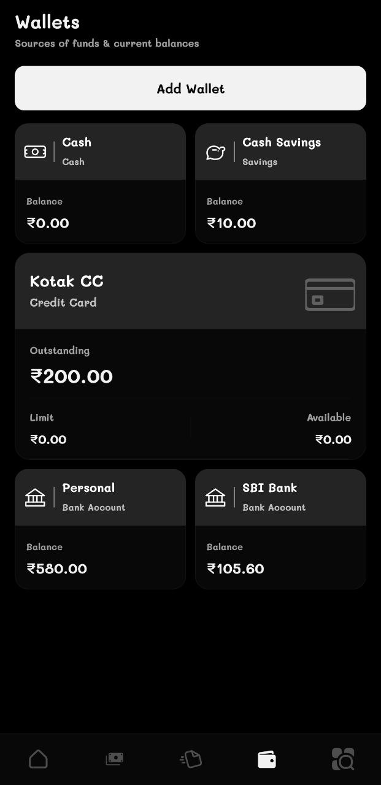 | 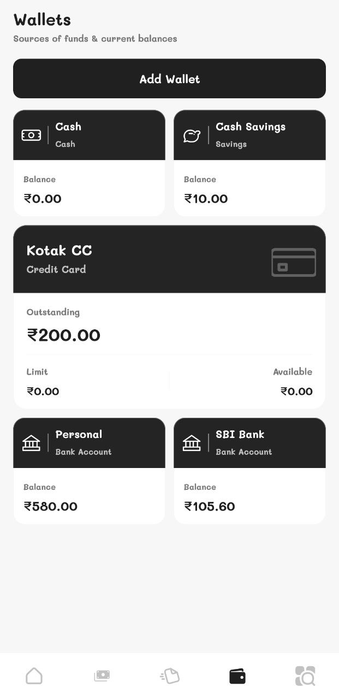 |
| **Credit Card:** Outstanding ₹200.00 &bull; Limit &bull; Available | **Wallets Grid:** Cash, Savings, Credit Card, Bank Accounts |

---

### 3. Transactions & Filter Tabs
*Search bar, compact transfer trigger, and instant filter chips (All, Expenses, Incomes, Transfers, Cash).*

| AMOLED Night Transactions | Clean Day Transactions |
|:---:|:---:|
| 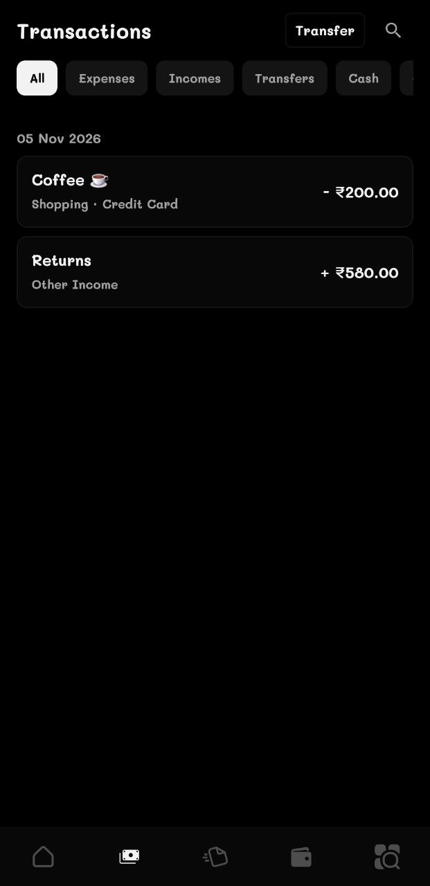 | 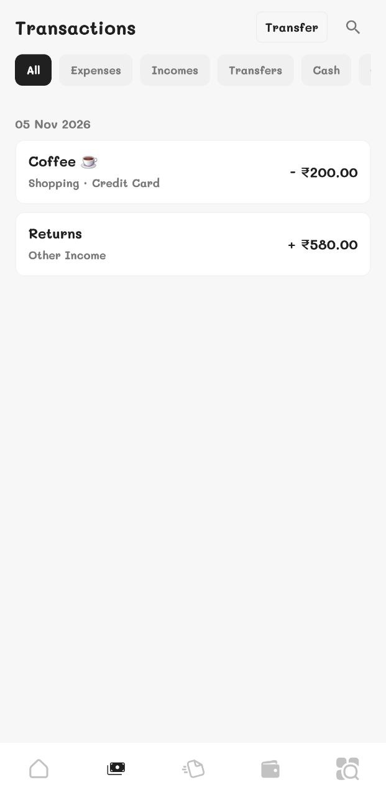 |
| **Transactions:** Date grouping and payment mode stamps | **Search Active:** [View with Search](docs/media/screen-light-transactions-search.jpg) |

---

### 4. Categories & Subtle Pastel Badges
*Monochrome typography and icons elevated by subtle pastel circular backgrounds for instant visual recognition.*

| AMOLED Night Categories | Clean Day Categories |
|:---:|:---:|
| 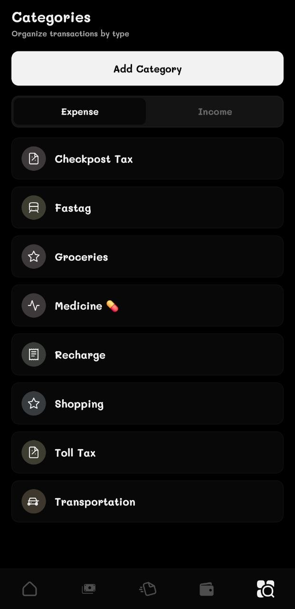 | 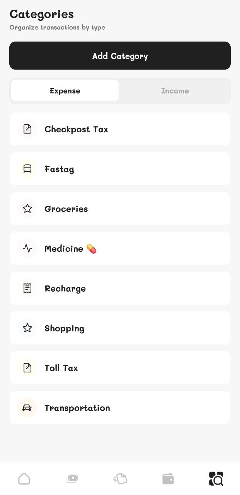 |
| Soft pastel background badges with dimmed night alpha | Clean pastel circular accents under monochrome icons |

---

### 5. Templates for Rapid Entry
*Pre-configured transactions for one-tap entry with strict type segregation.*

| AMOLED Night Templates | Clean Day Templates |
|:---:|:---:|
| 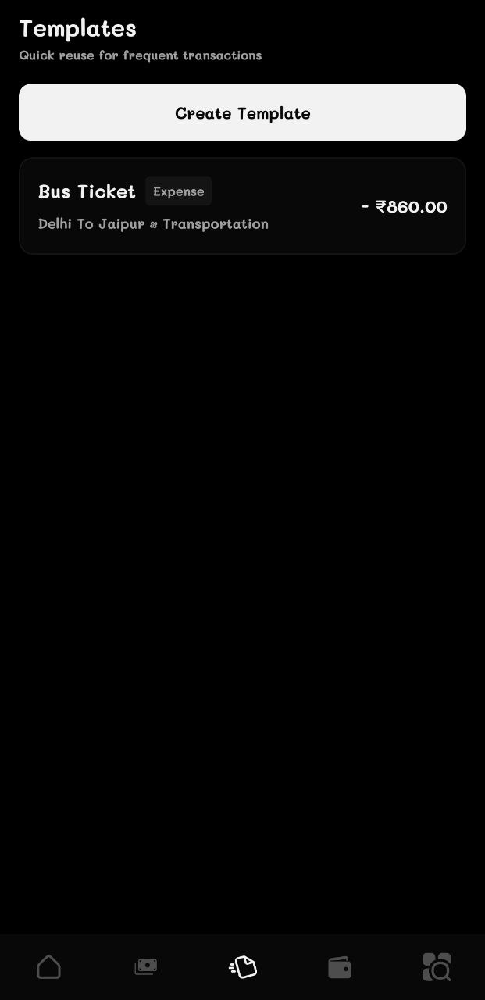 | 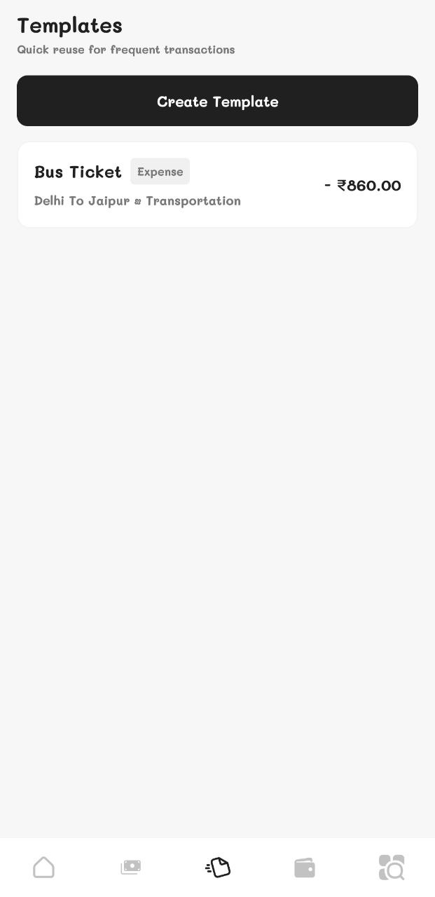 |

---

### 6. Settings, Themes & Portability
*Theme switcher (Device / Day / Night), JSON Backup & Restore, and version metadata.*

| AMOLED Night Settings | Clean Day Settings |
|:---:|:---:|
| 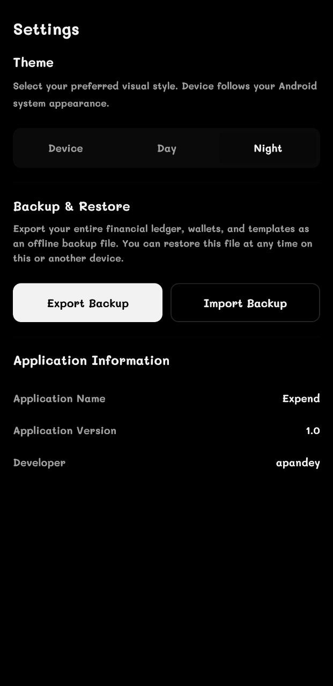 | 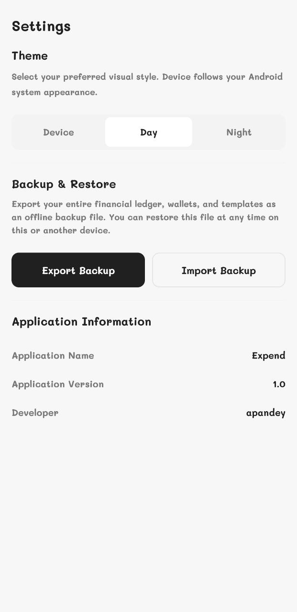 |

---

## 💳 Wallets & Credit Card Accounting

Expend treats credit cards as first-class financial liabilities rather than standard deposit accounts:

| Credit Card Details Sheet | Bank Account Details Sheet | Cash Wallet Details Sheet |
|:---:|:---:|:---:|
| 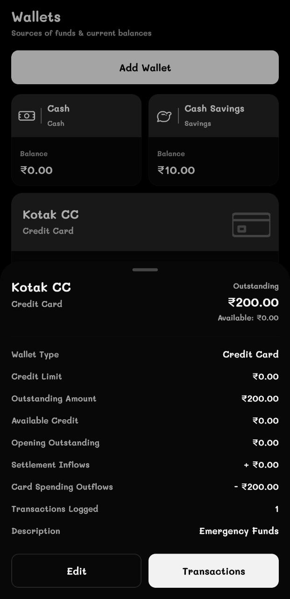 | 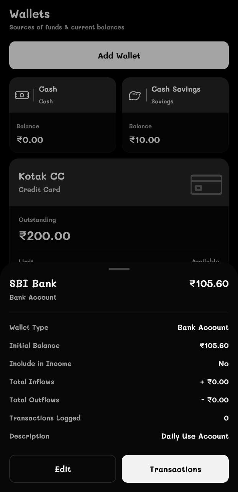 | 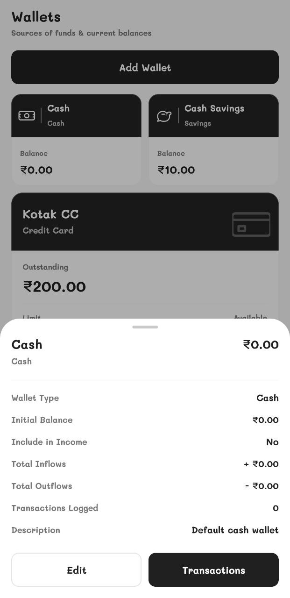 |
| **Kotak CC:** Live tracking of outstanding debt, credit limit, available headroom, and bill payment history. | **SBI Bank:** Complete tracking of initial balance, total inflows, and total outflows. | **Cash:** Quick access to Edit, View Transactions, and Archive. |

---

## 🎨 Category System & Icon Picker

Expend includes 40 built-in vector icons for personal budgeting:

| 40-Icon Selection Grid | Create Category Sheet | Category Actions Sheet |
|:---:|:---:|:---:|
| 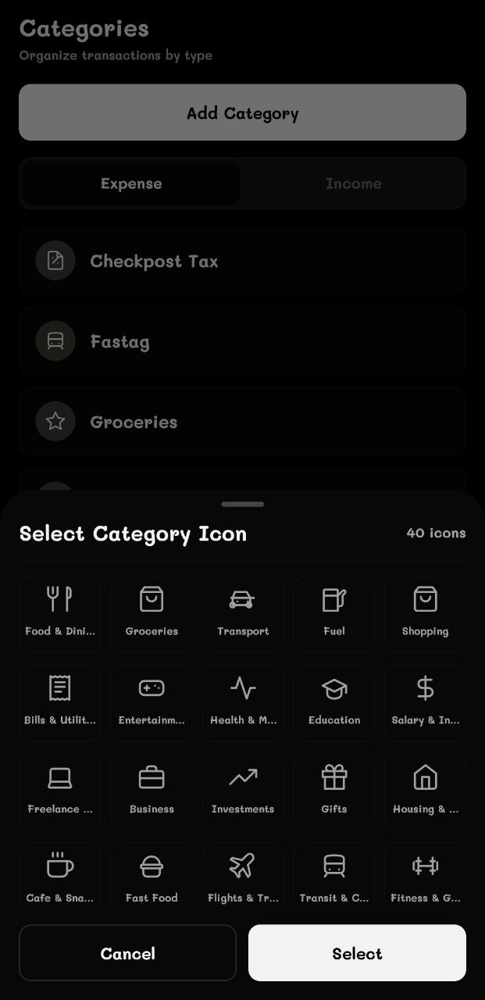 | 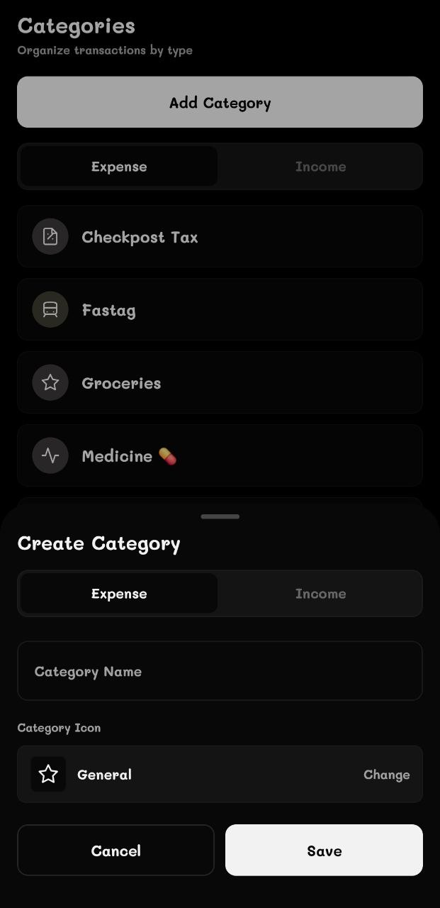 | 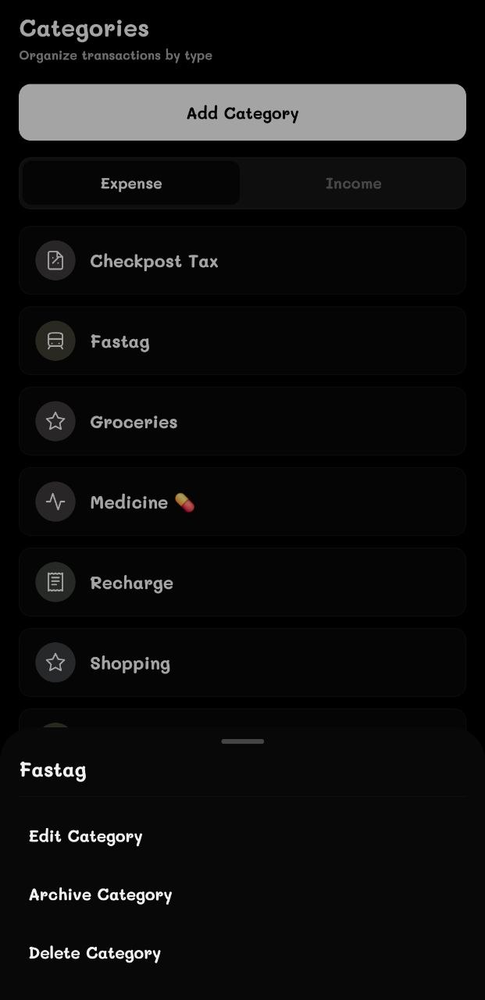 |
| **Icon Picker:** Food, Groceries, Fuel, Flights, Health, Transit, Subscriptions, and more. | **Create Category:** Expense or Income type with custom name and icon. | **Actions:** Edit, Archive, or Delete with safety prompts. |

---

## 📝 Transaction Management & Forms

Full-screen dedicated creation and editing forms following strict UX guidelines:

| Full-Screen Edit Transaction | Create Transfer Flow | Discard Confirmation |
|:---:|:---:|:---:|
| 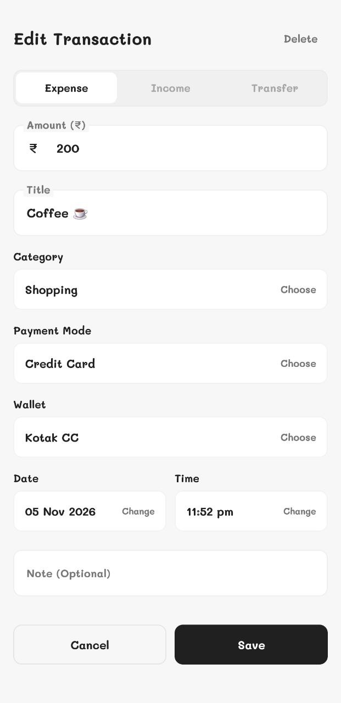 | 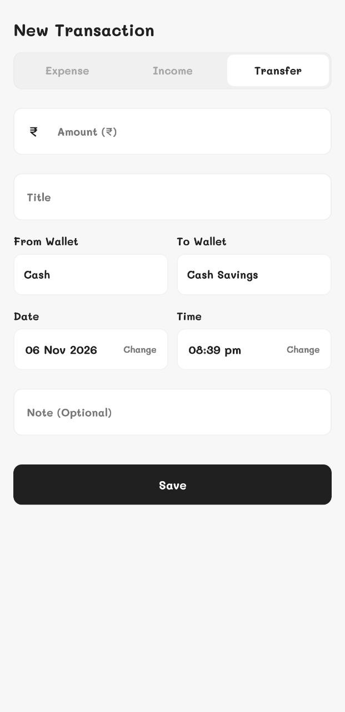 | 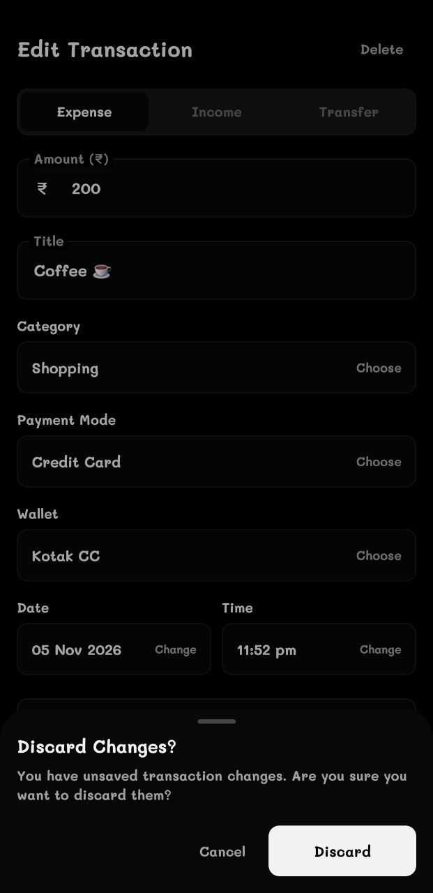 |
| Full-screen form with amount, title, category, payment mode, wallet, date, and custom time picker. | Direct wallet-to-wallet transfer without double-counting expenses. | Safe protection against accidental lost changes. |

  <a href="README.md">← Back to README</a> &bull; <a href="https://github.com/apandey-dev/expend">GitHub Repository</a>

